# oligo-mtDSB
<p align="center">
  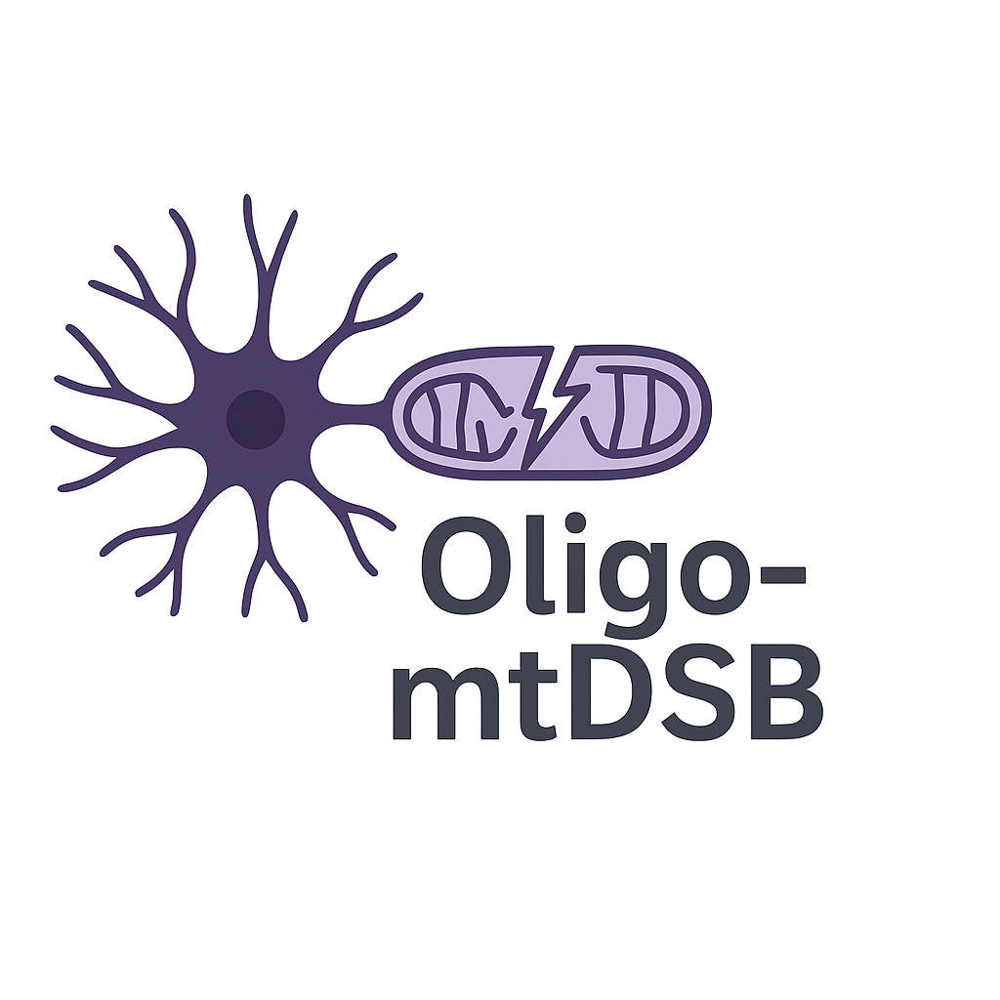
</p>

Consequences of double-stranded breaks (DSBs) in mitochondrial DNA (mtDNA) of oligodendrocytes (OLs), in a
genetically engineered mouse model (PlpTA:mtPst1), measured with 10x Xenium 5k spatial transcriptomics.

**Design.** 12 sections, one per mouse: DOX removal at P21 or P60 x control / mtDSB x 3, all collected 42 days
after induction. Cells carry a cell type (`cell_class`) and an anatomical compartment
(`RBD_compartment_simplified`). The mouse is the biological replicate in every test.

---

## Key findings at a glance (updated 2026-10-15)

| # | Finding | Key number | Evidence | Figure |
|---|---|---|---|---|
| 1 | **Only 3 of the 6 mtDSB mice respond, and they respond strongly**; the other 3 look like controls | ISR genes up 2-100x in RB4405, RB4401, RB4627 (P(responder) > 0.99 each); non-responders inside the control range (RB4630 borderline, P = 0.17) | strong | F2, R1 |
| 2 | **Responding oligodendrocytes switch on a stress programme, become immune-visible and lose myelin genes** | 34 genes up, 9 down; top genes replicate across cohorts (p = 2e-11) | strong | G3 |
| 3 | **The response is the same at both ages**; the earlier "weak at P21, strong at P60" was 1 vs 2 responders | model trained on P60 mice finds the P21 responder and vice versa | moderate | F3 |
| 4 | **It is brain-wide, strongest in the thalamus and white-matter tracts** | 31-55% of OLs stressed in responders vs 7-14% elsewhere | moderate | F9 |
| 5 | **Neighbouring microglia and astrocytes respond; blood-vessel cells do not** | astrocyte reactivity p = 0.012, microglial MHC-I p = 0.012, DAM p = 0.048 | moderate | N1 |
| 6 | **A microglia's own expression predicts how close it is to a stressed oligodendrocyte** (Cd68, Cd83, Trem2) | r 0.17 in responders vs 0.10 in controls, p = 0.012 | moderate | N3 |
| 7 | **The stress response comes before myelin loss** | share of stressed OLs that lost myelin: 0.40 -> 0.73 -> 0.90 with severity (controls 0.09-0.25) | moderate | N2 |
| 8 | **This confirms and explains the earlier analyses** | all 22 driver genes tested by the earlier Bayesian model agree in direction | strong | - |
| 9 | **The stress is regional and diffuse, not focal and not concentrated at the brain's borders** | no rise towards ventricles / meninges (p = 0.10, 0.25); neighbour coherence = controls | moderate (negative) | S1, S2 |
| 10 | **No repair response and no neuronal injury yet at 42 days** | immature-OL density p = 0.98; neuronal axon-injury genes p = 0.63-0.83 | moderate (negative) | S3, S4 |
| 11 | **T cells are rare and not more numerous in responders**; they hide in endothelial / astrocyte / OL clusters | 242 of 980k cells (shuffle null ~4); 3.4 vs 2.8 per 10k, p = 0.46; ~40% OL-labelled in RB4627 / RB4405 vs 0-19% in controls (p = 0.06) | moderate (negative) | T5, T6 |

Every mouse is predicted or scored by models that never saw it; "p" values compare the 3 responders with the 6
controls by exact permutation (smallest possible p = 0.012). Full claims, numbers and caveats:
**[`results/sample_classifier/FINDINGS.md`](results/sample_classifier/FINDINGS.md)**. Responders: RB4405, RB4401,
RB4627. Non-responders: RB4403, RB4653 and, less certainly, RB4630 (`analysis/07`).

---

## The findings in detail

### 1. Only 3 of the 6 mtDSB mice respond, and they respond strongly
Three independent readouts single out the same three mice: a stress gene set chosen from the literature beforehand
(ATF4 / integrated stress response: Atf4, Atf5, Ddit3, Trib3, Sesn2, ...), a classifier that never saw the disease
cluster, and the earlier "stressed oligodendrocyte" (DA-OL) cluster. The other three mtDSB mice are indistinguishable
from controls on every one of these genes. Formally, the mtDSB group is ~10x more variable than the controls
(p = 1e-4) while the group averages do not differ: half respond, half do not. Not explained by sex, genotype label,
sample swap (sex labels match Xist), white-matter content or Xenium slide.

<p align="center">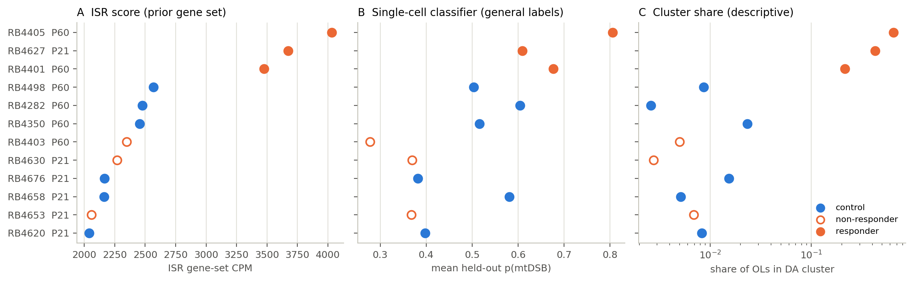<br>
<em>F2. Three readouts, same three mice. Filled orange = responders, open = non-responders, blue = controls.</em></p>

**How sure is each call?** (`analysis/07`, figure R1) A Bayesian mixture anchored on the controls gives each mouse a
probability of responding instead of a yes / no call. RB4627, RB4405 and RB4401 have P > 0.99 under every prior tried
(11-19 control SDs above their slide's controls); RB4653 and RB4403 lie below their slide's control mean (P < 0.01).
**RB4630 is the one open case (P = 0.17, range 0.01-0.34 across priors)**: 1.07x its slide's controls, above every
P21 control but far below any responder, so possibly a weak responder. No control, scored as if unlabelled, exceeds
P = 0.08. The responding fraction is 0.52 (90% interval 0.23-0.80).

<p align="center">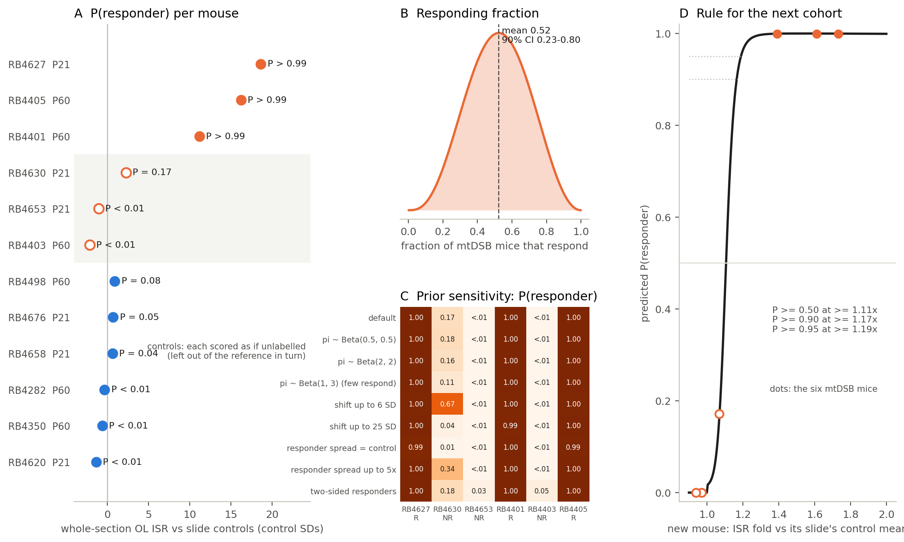<br>
<em>R1. A: P(responder) per mouse; B: responding fraction; C: robustness to the priors; D: the rule for the next cohort.</em></p>

### 2. What responding oligodendrocytes do
Genes that rise or fall with each cell's stress score *within the same tissue section* (so differences between
mice, slides or time of sacrifice cannot create them), required in all three responders and absent in controls:
* **up (34):** integrated stress response (Atf4, Atf5, Ddit3/CHOP, Trib3, Sesn2), mitochondrial and protein quality
  control (Hspa9, Sqstm1/p62, Lamp2, Gstp1, Mt2), cell cycle / survival (Cdkn1a/p21, Ccnd1, Myc, Bcl2l1),
  immune visibility (MHC class I H2-D1 / B2m, Cd40, Serpina3n);
* **down (9):** myelin / mature-oligodendrocyte genes (Mog, Cnp, Cldn11, Mal, Ugt8a, ...).

Models trained on completely separate mice (P21-only vs P60-only) pick the same top genes (10 of 50 shared,
p = 2e-11), and 6 of the 10 literature stress genes are recovered without being given to the analysis.

<p align="center">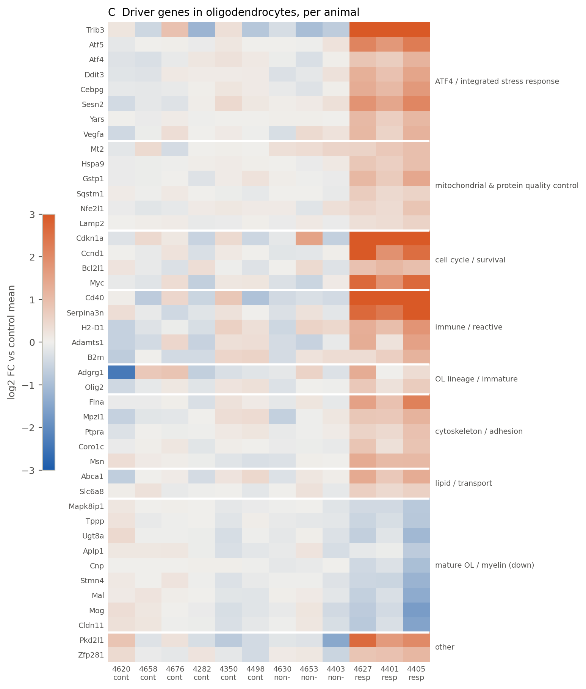<br>
<em>G3. The 43 driver genes per mouse (log2 fold change vs controls): up in the three responders, flat elsewhere.</em></p>

### 3. The response looks the same at both ages
A model trained only on the P60 mice ranks the P21 responder (RB4627) as the most mtDSB-like P21 mouse, and a model
trained only on P21 mice ranks the P60 responders top. The earlier impression of a weak P21 and a strong P60
response came from the P21 group having 1 responder of 3 and the P60 group 2 of 3; the P21 responder is as strong
as any. With 3 mice per cohort, 2 vs 1 responders says nothing about age.

### 4. Where: brain-wide, strongest in the thalamus and white-matter tracts
Every oligodendrocyte coloured by its stress (ISR) score, sections oriented dorsal up / midline right, colours
relative to control cells on the same slide (blue = below, red = above the control median). In responders 31-55% of
oligodendrocytes are above the control 90th percentile (7-14% in controls and non-responders). In controls the
white-matter oligodendrocytes have the *lowest* stress; in responders the thalamus and fiber-tract arcs turn red.

<p align="center">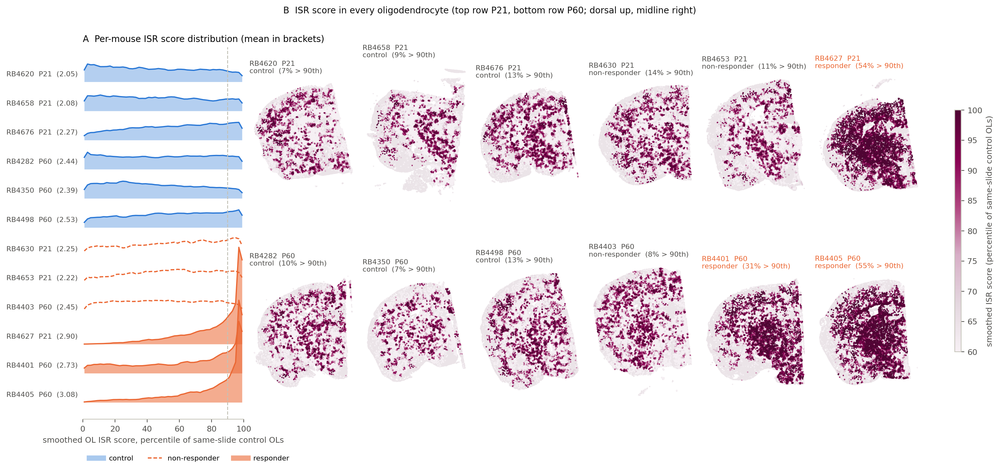<br>
<em>F9. Stress score in every oligodendrocyte. Left: per-mouse distributions; right: maps of all 12 sections.</em></p>

### 5. Neighbouring microglia and astrocytes respond; blood-vessel cells do not
For every microglia, astrocyte and endothelial cell we measured how stressed the oligodendrocytes within 50 um are
and compared that with the cell's own activation (gene sets from the literature), within the same section and brain
region. Only in responders: astrocytes near stressed oligodendrocytes are more reactive (p = 0.012), microglia more
antigen-presenting (MHC-I, p = 0.012) and more disease-associated (DAM, p = 0.048). Endothelial cells show nothing.
The same pattern holds at 30 and 100 um.

<p align="center">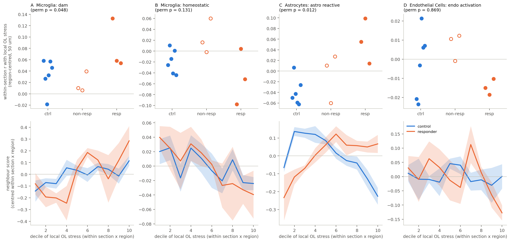<br>
<em>N1. Top: one dot per mouse. Bottom: neighbour activation across deciles of local oligodendrocyte stress.</em></p>

### 6. A microglia's own expression predicts how close it is to a stressed oligodendrocyte
A model reads a cell's gene expression and predicts its distance to the nearest stressed oligodendrocyte (adjusted
for brain region, distance to any oligodendrocyte and local oligodendrocyte density; every mouse predicted by a model
that never saw it). For microglia this works in responders and not in controls (held-out r 0.17 vs 0.10; every
responder above every control, p = 0.012), still holds with every oligodendrocyte-related gene removed (so it is not
leaked RNA from the neighbouring cell), and a responder-trained model does not work on controls. Microglia closer to
stressed oligodendrocytes express **Cd68, Cd83 and Trem2** (activated, phagocytic). Astrocytes: small consistent
excess (p = 0.024); endothelial cells: none. The correlation is modest (single cells are noisy); the evidence is the
consistent responder-vs-control difference.

<p align="center">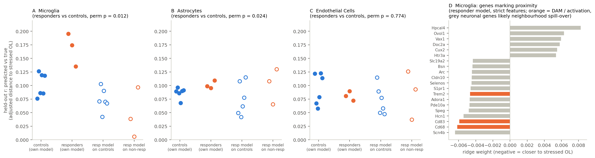<br>
<em>N3. Prediction accuracy per mouse (A-C) and the microglial genes that mark proximity (D).</em></p>

### 7. The stress response comes before myelin loss
Within responder tissue, each oligodendrocyte was classed as stressed (ISR high) and / or myelin-low, relative to
control cells of the same slide and brain region. In the mildest responder (RB4401) most stressed cells still have
normal myelin genes; with increasing severity (RB4627, RB4405) a growing share of stressed cells has also lost myelin
(0.40 -> 0.73 -> 0.90, controls 0.09-0.25, p = 0.012), and in the most severe mouse myelin loss extends beyond the
stressed cells. This snapshot is consistent with stress preceding myelin loss, a candidate prelude to the
demyelination seen at 4-6 months (it is not a time course).

<p align="center">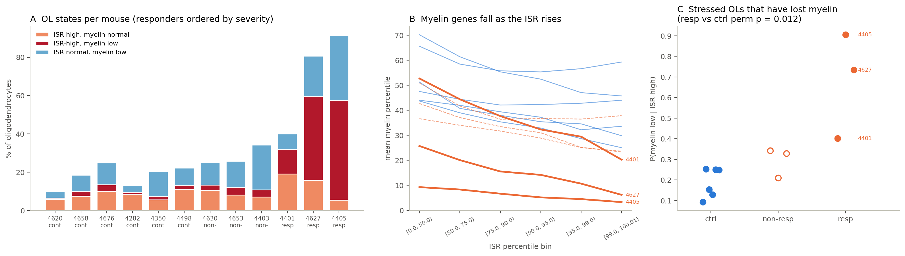<br>
<em>N2. Oligodendrocyte states per mouse (A), myelin genes vs stress level (B), stressed cells that lost myelin (C).</em></p>

### 8. This confirms and explains the earlier analyses
The earlier signal was real but carried by half of the mtDSB mice, which also explains why it looked weak or
age-dependent:
* **Hierarchical Bayesian case-control model** (`legacy/notebooks-02/09-12`): all 22 of today's driver genes it
  tested agree in direction (17 up, 5 down; p < 1e-6), 12 at its FDR < 0.05 (Mt2, Gstp1, B2m, H2-D1, Atf4, Atf5,
  Olig2 up; Cldn11, Cnp, Mal, Mog, Ugt8a down); its effects were small because it averaged responders with
  non-responders.
* **PyMC models** (`legacy/notebooks-01/29-30`): myelin identity down, Serpina3n up, as now.
* **Earliest per-mouse marker lists** (`legacy/notebooks-01/06`): RB4405 and RB4627 already showed today's genes.
* **DA-OL sub-clustering** (`legacy/notebooks-02/06`, `04/06`): the same programme; the cluster is the responder state.
* **Microglial DAM response** (manuscript sec. 3, 6): real, and restricted to the responders (Cd74, Cst7 10-30x).
* **What changes:** the P21-vs-P60 progression (responder composition); top "mtDSB genes" such as Sgk1, Fkbp5
  (stress hormones, vary between sections), Kif5a (one odd section) and Il33 (one control) were confounds.
  Claim-by-claim review of every earlier notebook: **[`docs/ANALYSIS_REVIEW.md`](docs/ANALYSIS_REVIEW.md)**.

### 9. The stress is regional and diffuse, not focal and not concentrated at the brain's borders
The IHC found immune cells at the ventral meninges, around the ventricle and in the internal capsule / thalamus, so
we asked whether oligodendrocyte stress starts at these borders. It does not: within each brain region, responder
oligodendrocytes are not more stressed near the ventricles or the meningeal surface (if anything slightly more
stressed farther away; p = 0.10 and 0.25), and they sit at the 75th-80th control percentile at every distance from the
ventricle. Nor is the stress focal: neighbouring oligodendrocytes share stress no more than in controls at any
distance up to 400 um. The response is a regional shift (thalamus, white matter) spread evenly within regions, not
lesions or an outside-in front from the CSF or meninges.

<p align="center">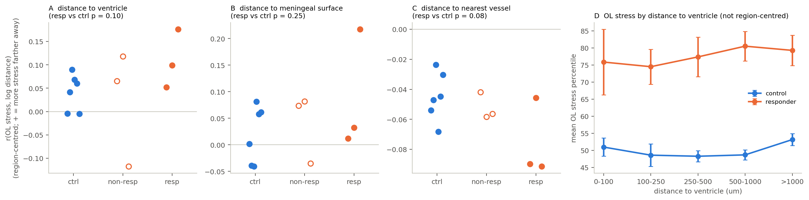<br>
<em>S1. Oligodendrocyte stress vs distance to ventricle, meninges and vessels. D: responders are elevated at every distance.</em></p>

### 10. No repair response and no neuronal injury yet at 42 days
* **Repair:** immature oligodendrocytes (precursor-like and pre-myelinating) are not more numerous near stressed
  oligodendrocytes (p = 0.98) or in responder brains (2.7% vs 2.9% of cells); a weak tendency towards proliferation in
  pre-myelinating cells near stressed oligodendrocytes is not significant (p = 0.07).
* **Neurons:** neurons near stressed oligodendrocytes show no consistent axonal-injury (regeneration-associated genes)
  or stress response.

So at 42 days the response is confined to oligodendrocytes and their glial neighbours (findings 5-6), with no
detectable repair attempt or neuronal damage: an early stage before the demyelination seen at 4-6 months. These are
negative results with 3 responders; they set the baseline for the chronic time points.

### 11. T cells are rare, sit at the borders, and are not more numerous in responders
No cluster or annotation contains T cells: at ~2.5 per 10k cells they are too few to cluster and take their
neighbours' labels (endothelial / leptomeningeal 55 %, astrocyte 18 %, DA-oligodendrocyte 15 %). Called per cell from
co-expression of core genes (>= 3 transcripts over >= 2 of Cd3d/e/g, Cd247, Cd2, Cd8a/b1, Itk, Cxcr6), 242 cells pass
against ~4 when genes are shuffled within each section. They are CD8 / Cxcr6 tissue-resident-type cells, mostly at the
meninges, ventricles and along vessels, and the polygons show small round cells with the transcripts inside. Responders
do not have more (p = 0.46); in RB4627 and RB4405 a larger share sits in the tissue among oligodendrocytes (p = 0.06).
**Probe warning:** Trbc1 and Ighm are dominated by off-target signal in cortical neurons (30k / 68k cells); a
Trbc1-based score calls ~6,000 false "T cells". (`analysis/08`, `utils/tcells.py`)

<p align="center">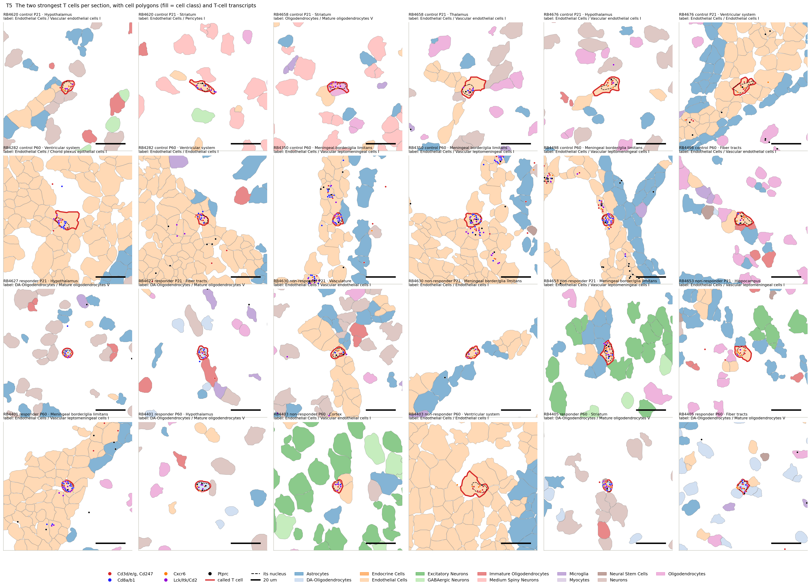<br>
<em>T5. The two strongest T cells per section: cell polygons coloured by class, T-cell transcripts as dots.
All 242: <code>results/tcells/figures/T5b_all_tcells_polygon_zooms.pdf</code>.</em></p>

---

## What we cannot claim (yet)

* **That mtDSB shifts the whole group.** Group averages do not differ; the effect is all-or-none per mouse.
* **An age difference in susceptibility.** 2 of 3 vs 1 of 3 responders is uninformative.
* **Anything about the age effect alone.** Each Xenium slide holds one age cohort (slide 0060539 = P60,
  0060541 = P21), so age and slide cannot be separated. The responder finding is unaffected: responders and
  non-responders share each slide.
* **A time course.** Every section is 42 days after induction; finding 7 is inferred from a snapshot.
* **Causality between cell types.** Findings 5-6 show co-location and coupling, not who signals to whom.
* **That there is no repair or neuronal effect at all.** Findings 9-10 are negative results with 3 responders and
  noisy single-cell scores; small effects could be missed.
* Notes: controls and mtDSB sections were mounted mirror-image on both slides (corrected for display); RB4403's
  doubled cell count is over-segmentation; control RB4620 is mtPst1-only (others PlpTA-only).

## What we need from collaborators

1. **Why do 3 mice not respond?** Induction check on remaining tissue (the unused 60-day fresh-frozen cohort includes
   RB4403 vs RB4401 / RB4405): mtPstI qPCR and an mtDNA damage assay. This decides how non-responders are treated.
   RB4630 is the mouse to check first (borderline, P(responder) = 0.17).
2. **Overlap with histology:** were RB4627, RB4401 or RB4405 among the mice with immune infiltrates (IHC, flow)?
   Xenium finds no excess of T cells in them, but more tissue-located T cells in RB4627 and RB4405 (finding 11);
   which cell types did the IHC stain?
3. **Next cohort design** (`analysis/05`, figure D1): with ~50% responders the classic group comparison stays under
   0.7 power even at 12 mice per group; with an induction check that excludes failed inductions, **5-6 mice per group
   give 0.8-0.9 power**. Put both age cohorts on every slide. Call responders with `utils/responder_mixture.py`:
   whole-section OL ISR >= 1.17x the slide's control mean gives P(responder) >= 0.9 (`analysis/07`, R1 D).

<p align="center">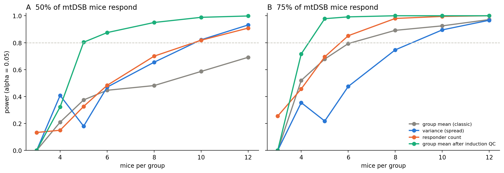<br>
<em>D1. Power by design (simulated from the observed per-mouse stress scores).</em></p>

## How the analysis works (in brief)

* **Leave-one-mouse-out classifiers** (`utils/sample_classifier.py`): predict each mouse's group from its
  expression with a model trained on the other mice, per cell type and region; general cell-type labels only.
* **Three readouts** (`utils/ol_response.py`): a literature stress (ISR) score, the classifier score per cell, and
  the DA-OL cluster share.
* **Within-section analyses** (`analysis/03`, `04`): genes and neighbour effects are measured by comparing cells in
  the *same* tissue section, so slide, section plane and time of sacrifice cannot create them.
* **Prespecified gene sets** (`utils/gene_sets.py`) for stress, myelin, microglia (DAM / homeostatic), reactive
  astrocytes, endothelial activation, MHC-I and interferon, fixed from the literature before use.

---

## Start here

| I want to ... | Go to |
|---|---|
| read the findings and their evidence | `results/sample_classifier/FINDINGS.md` |
| see the figures (F1-F9 responders / regions / score and ISR maps / checks; G1-G4 genes) | `results/sample_classifier/figures/`, `results/ol_gene_drivers/figures/` |
| check whether an earlier notebook's conclusion still holds | `docs/ANALYSIS_REVIEW.md` |
| regenerate figures and tables (laptop, no h5ad needed) | `analysis/02-ol-response-and-classifiers.ipynb`, `analysis/03-ol-stress-genes.ipynb` |
| region x time-point DE figures | `analysis/01-region-time-treatment-figures.ipynb` |
| T cells: calls, polygon close-ups, responders vs controls | `analysis/08-t-cells.ipynb` |
| understand the methods | docstrings of `utils/sample_classifier.py`, `utils/ol_response.py`, `utils/region_time_de.py` |
| check the code works without the data | `python tests/test_sample_classifier.py`, `tests/test_ol_response.py`, `tests/test_region_time_de.py` |
| edit the A0 poster (KI style, editable SVG; regenerate with `make_poster.py`) | `docs/poster/poster.svg` |
| read the manuscript draft (with review notes) | `results/paper/manuscript.md` (built from `results/paper/[0-9]*-*.md`) |
| see how the annotation / compartments were made | `legacy/notebooks-02/01-03`, `legacy/notebooks-02/13`, `legacy/notebooks-04/00`, `scripts/compartments/` |

## Repository layout

```
analysis/        current notebooks (figures + tables from the result folders; no h5ad needed)
  01-region-time-treatment-figures.ipynb   region x time-point DE
  02-ol-response-and-classifiers.ipynb     responders, classifiers, regions, checks   -> F1-F7
  03-ol-stress-genes.ipynb                 driver genes of the OL response            -> G1-G4
  04-neighbourhood-and-staging.ipynb       neighbour coupling, proximity model, staging -> N1-N3
  06-borders-patches-repair-neurons.ipynb  borders, focal vs diffuse, repair, neurons   -> S1-S4
  05-design-power.ipynb                    how many mice for the next cohort, which test  -> D1
  07-responder-probability.ipynb           P(responder) per mouse, rule for the next cohort -> R1
  08-t-cells.ipynb                         T-cell calls, polygon close-ups, responders vs controls -> T1-T6
utils/           maintained modules: sample_classifier, ol_response, spatial_orientation, gene_sets, neighbourhood, ol_staging, spatial_patterns, responder_mixture, tcells, region_time_de, region_time_plots, spatial_utils
scripts/         batch runs (need the h5ad): run_sample_classifier, run_ol_gene_drivers, run_region_time_de,
                 export_cell_table; compartments/ = read-based compartment cluster job
tests/           synthetic tests for the maintained modules
results/
  sample_classifier/   FINDINGS.md, figures F1-F7, tables, classifier outputs (per-cell scores gitignored)
  ol_gene_drivers/     gene weights, within-section associations, driver genes, figures G1-G4
  neighbourhood_staging/  coupling, ISR x myelin states, proximity-model tests, figures N1-N3
  proximity_model/     distance targets, ridge metrics and weights
  spatial_patterns/    border distances, correlogram, repair and neuron coupling, figures S1-S4
  responder_probability/  P(responder) per mouse and readout, prior sensitivity, next-cohort rule, figure R1
  tcells/              T-cell calls, probe QC, polygons / transcripts around each T cell, figures T1-T6
  region_time/         region x time DE tables (+ _cell_class_updated, _MANA250 example)
  cell_table/          sections.csv (age, condition, sex, genotype); cells.csv.gz gitignored
  paper/               manuscript sections + build_manuscript.py
docs/            ANALYSIS_REVIEW.md; poster/ (A0 poster SVG + generator)
legacy/          earlier work, kept for the record (not maintained; relative paths inside no longer resolve)
  notebooks-01 ... notebooks-04, utils_builder.ipynb
  utils/       auto-harvested helper modules
  results/     age, region, bayes, casecontrol_*, figures*, cell_types_*, compartments_all, rbd_highlight_*
assets/  data/ (gitignored)  logs/
```

---

## Reproducing the analysis

### Data location

The annotated h5ad files are **not in the repository**. They live on an external SSD (`/Volumes/processing2`)
normally attached to the office Mac (reachable over Tailscale; here `<office-mac>`). Copying over Tailscale
runs at ~2 MB/s (10 GB takes ~1.5 h), so run the h5ad steps on the office Mac or plug the disk in.

```
/Volumes/processing2/oligo-mtDSB/data/
    mtDNA_DSB_5k_clustered_annotation_with_rbd_2_cytetype_brain_novae4.h5ad   <- current: 980 474 cells x 5 101 genes,
                                                                                 layers['counts'] raw (10.4 GB)
    mtDNA_DSB_5k_clustered_annotation_MANA.h5ad                                <- 250 genes only; NOT for DE
    ... older intermediates
```

### Environments

| conda env | use for |
|---|---|
| `karospace311` (laptop) | all maintained code, tests, `analysis/` notebooks (scanpy, scikit-learn, pydeseq2 0.5.4) |
| `cellcharter-env` (office Mac) | the h5ad steps below (scikit-learn, anndata, pydeseq2) |
| `sopa` (office Mac) | `export_tcells.py` (needs polars: pyarrow fails on the raw `transcripts.parquet`) |

### Steps

```bash
H5AD=/Volumes/processing2/oligo-mtDSB/data/mtDNA_DSB_5k_clustered_annotation_with_rbd_2_cytetype_brain_novae4.h5ad
# office Mac (h5ad):
python scripts/run_region_time_de.py --h5ad $H5AD --outdir results/region_time --layer counts --n-cpus 12   # 27 min
python scripts/run_sample_classifier.py --h5ad $H5AD --outdir results/sample_classifier/cells_general \
    --merge DA-Oligodendrocytes=Oligodendrocytes                                                            # ~30 min, resumable
python scripts/run_ol_gene_drivers.py --h5ad $H5AD --outdir results/ol_gene_drivers \
    --cell-scores results/sample_classifier/cells_general/cell_scores/Oligodendrocytes.csv.gz               # 1-2 min
python scripts/export_cell_table.py --h5ad $H5AD --outdir results/cell_table                               # 1 min
python scripts/export_ol_gene_scores.py --h5ad $H5AD --out results/cell_table/ol_gene_scores.csv.gz      # 1 min (per-OL ISR score)
python scripts/export_cell_gene_scores.py --h5ad $H5AD                                                    # 1 min (all cells, prespecified sets)
python scripts/run_proximity_model.py --h5ad $H5AD                                                       # ~45 min (needs targets from analysis/04)
python scripts/export_tcells.py --h5ad $H5AD --raw-dir /Volumes/moldiassd/oligo-mtDSB/raw_xenium/run4   # 3 min, sopa env (polars)
# laptop (no h5ad):
python scripts/run_sample_classifier.py --pseudobulk results/region_time \
    --outdir results/sample_classifier/pseudobulk_general --merge DA-Oligodendrocytes=Oligodendrocytes     # 3 min
jupyter nbconvert --to notebook --execute --inplace analysis/0[1-3]-*.ipynb
```

### Methods in brief

* **Classifiers** (`utils/sample_classifier.py`): L2 logistic regression, balanced classes. Pseudobulk level:
  one model per (cell type, region) on centered log-CPM, exact kernel solution, sample-level permutation tests
  (floors: 1/400 pooled, 1/20 within-cohort / transfer). Single-cell level: one model per cell type, 2000
  cells per training section, every cell of the held-out section scored. Tasks: `age`, `condition`, `joint`,
  `condition@21/@60`, `condition 21->60 / 60->21` (train on one cohort, predict the other).
* **Responders and driver genes** (`utils/ol_response.py`): ISR score from 10 prespecified ATF4 targets;
  driver genes = within-section correlation with the out-of-fold OL score, r > 0.1 in each responder and
  < 0.1 in controls and non-responders (fixed before looking at genes).
* **Region x time DE** (`utils/region_time_de.py`): section-level pseudobulk, pyDESeq2 per (cell type,
  region, age), joint `~ age + condition + age:condition` models, region-vs-rest tests.

### Caveats when reading `results/region_time/`

* **Neuropeptide spill-over:** Hcrt, Pmch, Sst, Pdyn appear as top "glial" hits in the hypothalamus; they are
  neuronal transcripts picked up by neighbouring segmented cells.
* **Neural Stem Cells @ Ventricular system @ P60** (671 hits) reflects section plane / ventricle coverage,
  not regulated genes.
* Group-level mtDSB vs control tests average responders with non-responders (see Headline).

---

## Analysis history

1. Cluster annotation, refined with cytetype and manual merging (`legacy/notebooks-02/13`, `legacy/notebooks-04/00`).
2. Read-based anatomical compartments (`scripts/compartments/`, `legacy/notebooks-02/03`).
3. DEGs across condition and time, whole tissue and per region (`legacy/notebooks-01/25-26`, `legacy/notebooks-02/04`).
4. Hierarchical Bayesian case-control models (`legacy/notebooks-01/28-30`, `legacy/notebooks-02/09-12`).
5. 2026-09: consolidated region x time-point DE pipeline (`utils/region_time_de.py`, `analysis/01`).
6. 2026-10-14: leave-one-mouse-out classifiers, OL responder finding, within-section driver genes
   (`analysis/02-03`); all earlier analyses re-checked in `docs/ANALYSIS_REVIEW.md`; repository split into
   current (`analysis/`, `results/`) and `legacy/`.

## Background references
- https://pmc.ncbi.nlm.nih.gov/articles/PMC5647772/
- https://scholarship.miami.edu/view/pdfCoverPage?instCode=01UOML_INST&filePid=13386228880002976&download=true
